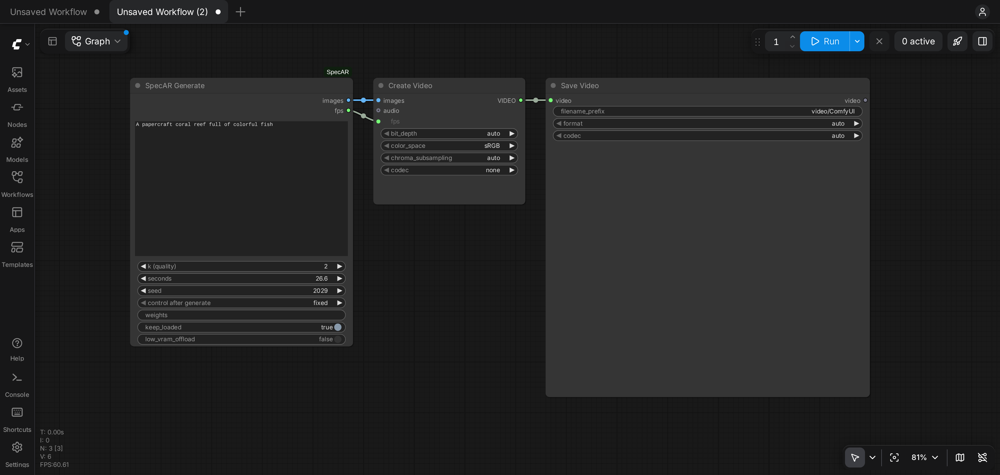
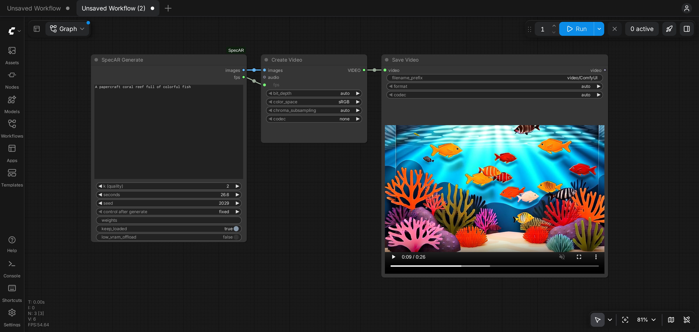

# ComfyUI-SpecAR

Runs [SpecAR](https://github.com/statite-ai/SpecAR) text-to-video on Krea Realtime 14B in ComfyUI. It adds one node,
**SpecAR Generate**, and calls the installed `specar` package.

## Install

```bash
git clone https://github.com/comfyanonymous/ComfyUI && cd ComfyUI
python3.11 -m venv .venv-krea && source .venv-krea/bin/activate
pip install -r requirements.txt "specar[krea] @ git+https://github.com/statite-ai/SpecAR"
git clone https://github.com/statite-ai/ComfyUI-SpecAR custom_nodes/ComfyUI-SpecAR
specar download --backbone krea --weights models/specar/krea
python main.py
```

`specar` pins exact library versions, including torch, so use a separate environment. The download is about 50 GB.

## Use

1. Open http://127.0.0.1:8188.
2. Go to **Templates**, find **ComfyUI-SpecAR** and open **SpecAR**. You can also drag `example_workflows/SpecAR.json` onto the page.
3. Type your prompt in **SpecAR Generate**.



4. Click **Run**. The first run loads the models, which takes about 3 minutes. Later runs start right away.
5. The video plays in **Save Video** and is saved in `output/video`.



### Settings

| Input | Meaning |
|---|---|
| `prompt` | The text prompt |
| `k (quality)` | How much of the video the large target model generates; the small drafter generates the rest. Higher is slower, and 2 is the fastest setting |
| `seconds` | Video length, rounded to the nearest 0.75 s. 26.6 s (426 frames) is the tested length |
| `seed` | Random seed. Set it to fixed to reproduce a video |
| `weights` | Weights folder; empty means `models/specar/krea`. You can change it without restarting ComfyUI |
| `keep_loaded` | Keep the models loaded for the next run. Changing the prompt then takes under a second |
| `low_vram_offload` | Keep only the active model on the GPU. On by default on GPUs under 75 GiB |

## GPU memory

Measured on one H100 for a 26.6 s video:

| Setting | Peak GPU memory | Generation time, k = 2 | Generation time, k = 7 |
|---|---|---|---|
| `low_vram_offload` off | 44.5 GiB | 30 s | 39 s |
| `low_vram_offload` on | 41.9 GiB | 34 s | 46 s |

Offload also ran within a 48 GB limit set on the H100. Either setting needs more than 40 GB of GPU memory, because the
target model and its context cache must be on the GPU together. Offload keeps the model weights in system RAM, which we
estimate at about 40 GB.

Tested on H100 (FlashAttention 3) and B200 (FlashAttention 4), which are selected automatically. Peak memory is the same on
both, and on a B200 a 26.6 s video at k = 2 generates in 19 s. Other NVIDIA GPUs with enough memory need FlashAttention 2
(`pip install flash-attn`) and are untested. A different attention kernel can give a different video for the same seed, so
the reference hashes apply only to FlashAttention 3 on Hopper GPUs.

## Reproducibility

With FlashAttention 3 on an H100, the latents and 8-bit frames from this node matched `specar generate` bit for bit, and
the latents matched the `specar-benchmark` reference hashes, with offload on or off. Save Video uses its own encoder, so
the mp4 file differs from the one `specar generate` writes, and encoding adds about 30 s at 426 frames.

## License

This node is Apache-2.0. It imports `specar` and contains none of its code. SpecAR's Krea backend is CC BY-NC-SA 4.0,
which allows non-commercial use only, and model weights carry their own licenses. See the
[SpecAR license notes](https://github.com/statite-ai/SpecAR#license).
